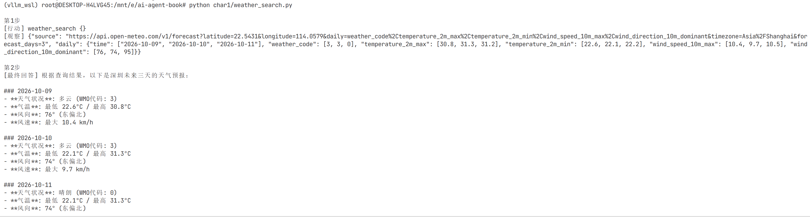
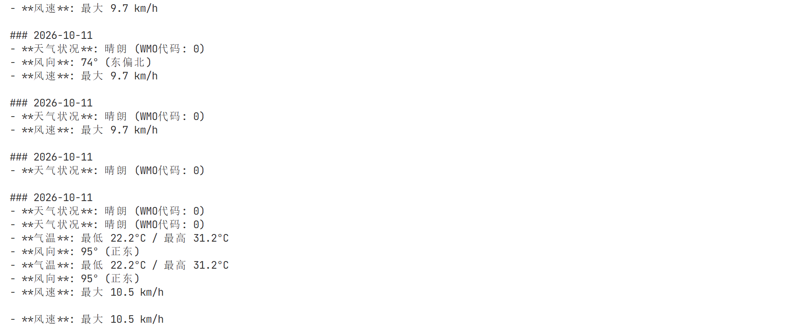

# Chapter 1 — Agent 初探

本章通过多个最小可运行示例，快速搭建对 Agent 的直观认识。所有脚本共用仓库根目录的 `config.yaml` + `.env`，**请从仓库根目录启动**。

## 环境准备

```bash
pip install -r requirements.txt
```

根目录 `.env` 至少需要：

```
DASHSCOPE_API_KEY=你的通义百炼 key
QWEN_API_BASE_URL=https://dashscope.aliyuncs.com/compatible-mode/v1
# 可选：图像生成接口单独地址
# QWEN_IMAGE_API_BASE_URL=...
```

根目录 `config.yaml` 中 `model`、`agent`、`image`、`experiment_1_4` 节点分别对应各脚本参数。

## 文件一览

| 文件 / 目录 | 类型 | 说明 |
|-------------|------|------|
| `hello_world.py` | 示例 0 | 最简 "Hello LLM"：走 Chat Completions，调用一次模型打印回复 |
| `web-search-agent/weather_search.py` | 示例 1 | 最简 ReAct Agent：本地注册 `weather_search` 函数工具，模型自主决定何时调用 |
| `context/context_experiment.py` | 实验 1-1 | 上下文消融对照：同一财务换算任务跑 5 组（full / no_history / no_reasoning / no_tool_calls / no_tool_results），比较成功率和工具调用行为 |
| `search-codegen/distance.py` | 实验 1-3a | 托管工具版 Responses API：搜索东盟 10 国首都坐标 → 托管 Python 用 Haversine 公式算 45 对距离 |
| `search-codegen/bitcoin_analysis.py` | 实验 1-3b | 两轮 Responses API：先让模型澄清含糊的 BTC 需求 → 用户补齐后再搜索 + 托管 Python 算 MA7/MA20/RSI14/MACD |
| `image-gen-workflow/image_gen.py` | 实验 1-4 | 文生图工作流对照：同一批中文需求分别"直出图"和"先经 LLM 改写 prompt 再出图"，输出到带 manifest 的结果目录 |
| `思考题.md` | 习题 | 章节思考题与个人解答 |

## 两种 API 模式

| 模式 | 使用的脚本 | 特点 |
|------|------------|------|
| Chat Completions + 本地 function tools | `hello_world.py`（无工具）、`web-search-agent/weather_search.py`、`context/context_experiment.py` | 工具在本地 Python 里实现，再通过 `tools=[{...}]` 注册给模型；需手动 ReAct 循环、手动拼接 tool 结果 |
| Responses API + DashScope 托管工具 | `search-codegen/distance.py`、`search-codegen/bitcoin_analysis.py` | 直接声明 `{"type": "web_search"}` / `{"type": "code_interpreter"}`，搜索和 Python 计算都在服务端完成；支持 `stream=True` 和 `previous_response_id` 续接上下文 |

## 运行

```bash
# 示例 0 / 1：最简对话 + 最简 ReAct
python char1/hello_world.py
python char1/web-search-agent/weather_search.py

# 实验 1-1：上下文消融
python char1/context/context_experiment.py --dry-run          # 先只检查配置
python char1/context/context_experiment.py                   # 跑全部 5 组
python char1/context/context_experiment.py --modes full no_history --max-iterations 15

# 实验 1-3：托管工具（Responses API）
python char1/search-codegen/distance.py --dry-run
python char1/search-codegen/distance.py
python char1/search-codegen/bitcoin_analysis.py --dry-run
python char1/search-codegen/bitcoin_analysis.py --interactive # 第一轮澄清后手动补全需求

# 实验 1-4：文生图对照（需要 config.yaml 里 image + experiment_1_4.cases）
python char1/image-gen-workflow/image_gen.py --dry-run
python char1/image-gen-workflow/image_gen.py --route rewritten  # 只跑改写路线
```

## 小提示

- `web-search-agent/weather_search.py` 使用 [Open-Meteo](https://open-meteo.com/) 免费天气 API，无需额外申请 key。
- `context/context_experiment.py` 的安全计算实现用 AST 限制表达式长度和节点数，防止模型生成恶意 Python。
- `search-codegen/` 下两个脚本的验收条件都是"必须由托管 Python 真实算出并打印 marker"，不是口头声称。
- 所有带 `--dry-run` 的脚本都支持在不消耗 API 的前提下预览请求和配置。

## weather_search.py 运行示例

!  

